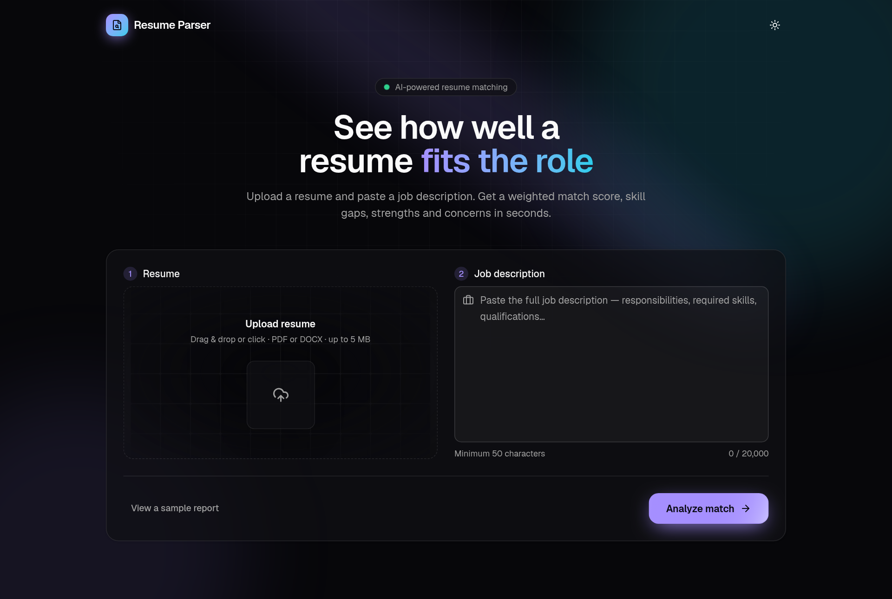
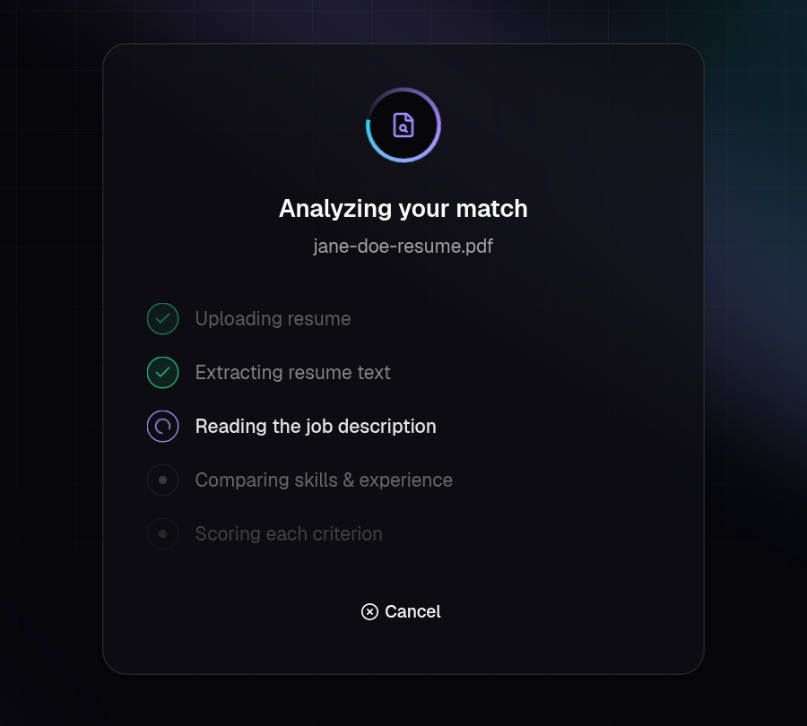
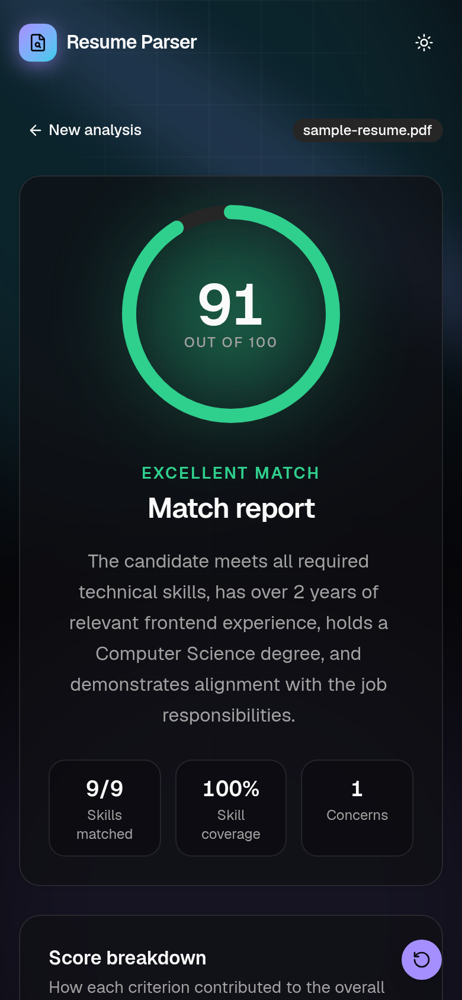
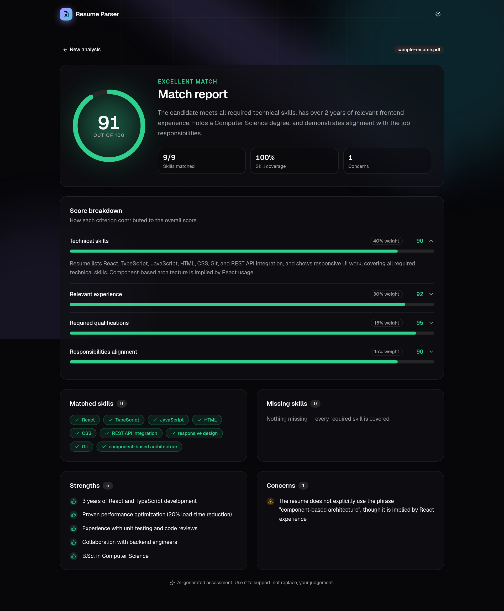

# Resume Parser

AI-powered resume and job description matching. Upload a resume (PDF or DOCX) and paste a job description to get a weighted match score, matched and missing skills, strengths, and concerns.



## Features

- **Resume parsing:** extracts text from PDF (PyMuPDF) and DOCX (python-docx) files up to 5 MB.
- **AI matching:** an LLM served by [Groq](https://groq.com) scores the resume against the job description on four weighted criteria.
- **Evidence-based scoring:** the prompt tells the model to score only what the resume shows, to ignore personal demographics, and to treat both documents as data, not instructions.
- **Animated report:** a score ring, an expandable breakdown per criterion, skill tags, and lists of strengths and concerns.
- **Responsive UI** with light and dark themes. It respects the "reduce motion" accessibility setting.

| Analyzing | Match report (mobile) |
| --- | --- |
|  |  |

<details>
<summary>Full match report (desktop)</summary>



</details>

## How scoring works

The overall score is the weighted average of four criteria, each scored from 0 to 100:

| Criterion | Weight |
| --- | --- |
| Technical skills | 40% |
| Relevant experience | 30% |
| Required qualifications | 15% |
| Responsibilities alignment | 15% |

The backend checks the model's JSON against a Pydantic schema before returning it.

## Tech stack

| Layer | Tools |
| --- | --- |
| Frontend | React 19, TypeScript, Vite, Tailwind CSS v4, shadcn/ui, Motion (Framer Motion), Aceternity-style components |
| Backend | Python 3.14, FastAPI, Pydantic, PyMuPDF, python-docx, uv |
| AI | Groq API (default model: `openai/gpt-oss-120b`) |
| Hosting | Vercel (frontend), Render via Docker (backend) |

## Project structure

```
resume_parser/
├── backend/
│   ├── app/
│   │   ├── main.py                # FastAPI app and routes
│   │   ├── core/config.py         # Settings read from environment / .env
│   │   ├── schemas/               # Pydantic request and response models
│   │   └── services/              # Resume text extraction, matching prompt, Groq client
│   ├── Dockerfile
│   └── pyproject.toml
├── frontend/
│   └── src/
│       ├── App.tsx                # Form → loading → report flow
│       ├── lib/api.ts             # API client and response types
│       └── components/            # Form, report, animated and shadcn/ui components
├── docs/screenshots/
└── render.yaml                    # Render deployment config for the backend
```

## Getting started

### Prerequisites

- Python 3.14+ and [uv](https://docs.astral.sh/uv/)
- Node.js 20+
- A free Groq API key from [console.groq.com/keys](https://console.groq.com/keys)

### 1. Backend

```bash
cd backend
cp .env.example .env        # then set GROQ_API_KEY in .env
uv sync
uv run uvicorn app.main:app --reload
```

The API runs at `http://localhost:8000`. Interactive docs are at `http://localhost:8000/docs`.

### 2. Frontend

```bash
cd frontend
npm install
npm run dev
```

Open `http://localhost:5173`. In development, Vite forwards `/api` requests to the backend on port 8000, so no extra setup is needed.

To see the report UI without a backend or API key, click **View a sample report**.

## API

### `GET /api/v1/health`

Returns `{"status": "ok", "message": "Resume Parser API is running"}`.

### `POST /api/v1/matches`

`multipart/form-data` with two fields:

| Field | Type | Rules |
| --- | --- | --- |
| `file` | file | `.pdf` or `.docx`, at most 5 MB |
| `job_description` | string | 50 to 20,000 characters |

```bash
curl -X POST http://localhost:8000/api/v1/matches \
  -F "file=@resume.pdf" \
  -F "job_description=We are hiring a frontend engineer with React and TypeScript..."
```

<details>
<summary>Example response</summary>

```json
{
  "overall_score": 91,
  "summary": "The candidate meets all required technical skills, has over 2 years of relevant frontend experience, holds a Computer Science degree, and demonstrates alignment with the job responsibilities.",
  "matched_skills": ["React", "TypeScript", "JavaScript", "HTML", "CSS", "REST API integration", "responsive design", "Git", "component-based architecture"],
  "missing_skills": [],
  "strengths": [
    "3 years of React and TypeScript development",
    "Proven performance optimization (20% load-time reduction)",
    "Experience with unit testing and code reviews"
  ],
  "concerns": [
    "The resume does not explicitly use the phrase \"component-based architecture\", though it is implied by React experience"
  ],
  "criteria": [
    {
      "name": "Technical skills",
      "score": 90,
      "weight": 40,
      "explanation": "Resume lists React, TypeScript, JavaScript, HTML, CSS, Git, and REST API integration..."
    }
  ]
}
```

</details>

| Status | Meaning |
| --- | --- |
| `400` | The file is not a PDF or DOCX |
| `413` | The file is larger than 5 MB |
| `422` | The resume could not be read, or a form field is invalid |
| `502` | The AI service failed or returned an invalid response |

Errors return `{"detail": "..."}`.

## Environment variables

**Backend** ([backend/.env.example](backend/.env.example))

| Variable | Required | Default | Description |
| --- | --- | --- | --- |
| `GROQ_API_KEY` | Yes | none | Groq API key |
| `GROQ_MODEL` | No | `openai/gpt-oss-120b` | Groq model ID |
| `CORS_ORIGINS` | No | `http://localhost:5173` | Comma-separated frontend URLs allowed to call the API |

**Frontend** ([frontend/.env.example](frontend/.env.example))

| Variable | Required | Description |
| --- | --- | --- |
| `VITE_API_BASE_URL` | In production | Backend URL, e.g. `https://resume-parser-api.onrender.com`. Leave it unset for local development. |

## Deployment (free)

The backend runs on Render's free plan, and the frontend runs on Vercel's free plan.

1. **Backend on [Render](https://render.com):** choose **New → Blueprint** and select this repo. Render reads [render.yaml](render.yaml). Enter `GROQ_API_KEY` when prompted. Check that `https://<your-api>.onrender.com/api/v1/health` responds.
2. **Frontend on [Vercel](https://vercel.com):** import the repo, set **Root Directory** to `frontend`, and add `VITE_API_BASE_URL` with your Render URL.
3. **Connect them:** in Render, set `CORS_ORIGINS` to your Vercel URL, for example `https://resume-parser.vercel.app`.

Every push to `main` then redeploys both.

> Render's free plan puts the backend to sleep after 15 minutes without requests. The next request can take about a minute while it starts. The frontend calls `/api/v1/health` when the page opens, so the backend usually finishes starting while the user fills in the form.

## Privacy note

Resumes are processed in memory and are not stored by this app. Resume text is sent to Groq for analysis, so check [Groq's data policies](https://groq.com/privacy-policy/) before you use real candidate data.
